

  <picture>
    <source media="(prefers-color-scheme: dark)" srcset="docs/images/breathe-dark.gif">
    
  </picture>

# Breathe

> **Breathe will never be about making money. It will always be about helping people.**

  

  <a href="https://papareaps.github.io/Breathe/"><b>Open Breathe Money →</b></a>
  &nbsp;·&nbsp; Free &nbsp;·&nbsp; No sign-up &nbsp;·&nbsp; Works offline &nbsp;·&nbsp; Add it to your phone's home screen

Breathe is a family of free, open-source apps that make everyday life easier for people with ADHD, and for anyone who finds everyday organisation hard.

It is a personal project, built by someone who struggles with these things too. There is enough stress in the world already. Breathe apps should reduce stress, never add to it.

## Breathe Money in 15 seconds

<table>
  <tr>
    <td width="300"><picture><source media="(prefers-color-scheme: dark)" srcset="docs/images/demo-dark.gif">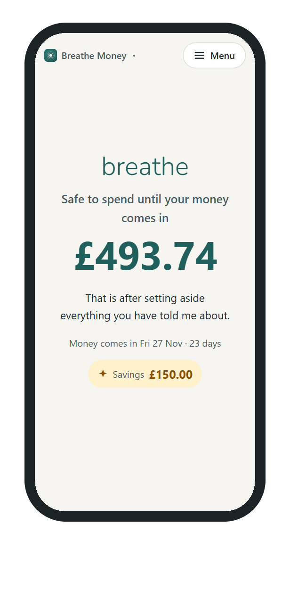</picture></td>
    <td>
      <h3>One question, one calm answer</h3>
      
<b>"How much can I spend until my money comes in?"</b>

      
Type what's in your account. Breathe Money sets aside your bills, food and travel, and some savings you choose to keep aside. Then it shows what's left as one big number.

      
Change anything and the number updates as you type. Dark mode follows your phone's own setting.

      
<a href="https://papareaps.github.io/Breathe/">Try it now</a>, with no account and no download.

    </td>
  </tr>
</table>

*All numbers in these pictures are made up.*

## What it does

### Your number, and where it comes from

<table>
  <tr>
    <td>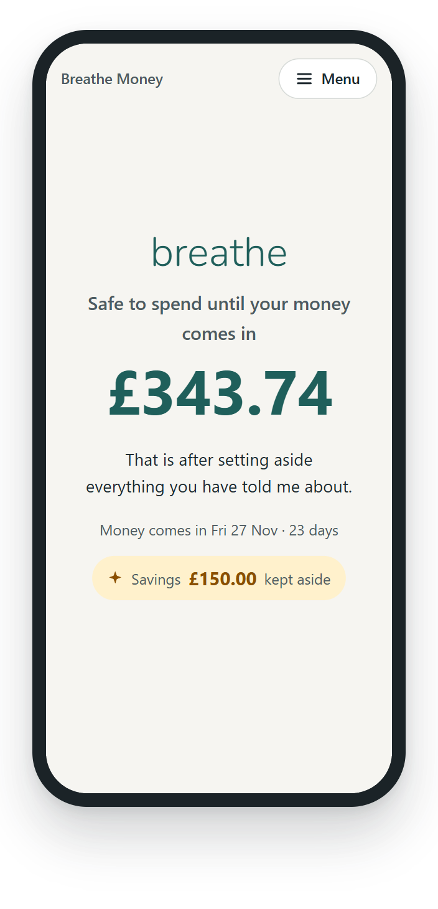</td>
    <td></td>
    <td>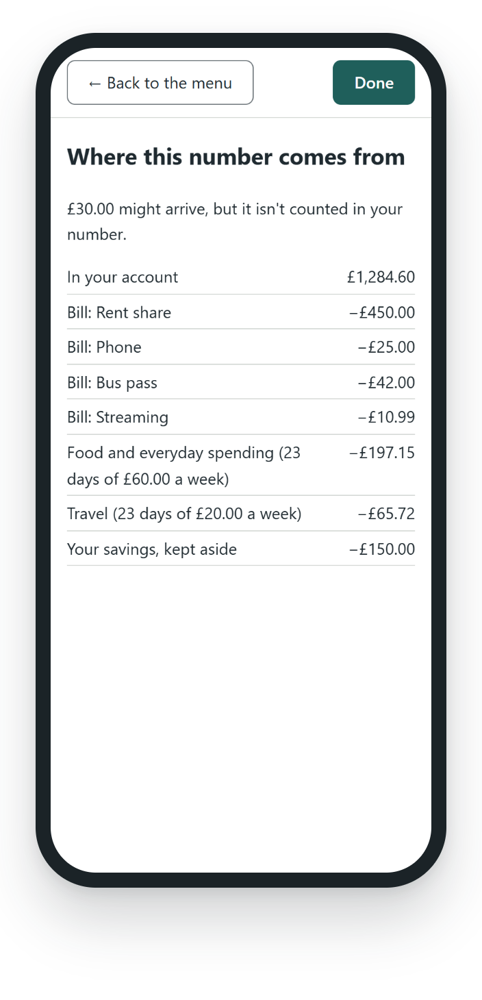</td>
  </tr>
  <tr>
    <td align="center">Just the number</td>
    <td align="center">Everything else lives in the Menu</td>
    <td align="center">Every pound explained</td>
  </tr>
</table>

- Shows how much is **safe to spend until your money comes in** (wages, benefits or a pension), after your bills, food and travel, and some savings kept aside.
- Counts every pound **once**. Bills already taken from your balance aren't taken off twice, and money that might not arrive is never counted.
- Explains **where the number comes from**, line by line, so you never have to just trust it.
- Handles real life: money that comes in on a weekend or bank holiday, bills due on that day, and a balance that's a few days old.

### Gentle setup, tidy lists

<table>
  <tr>
    <td>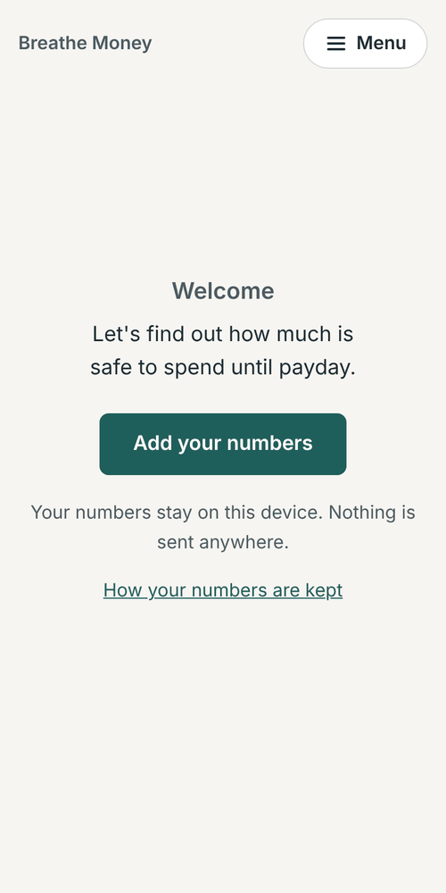</td>
    <td>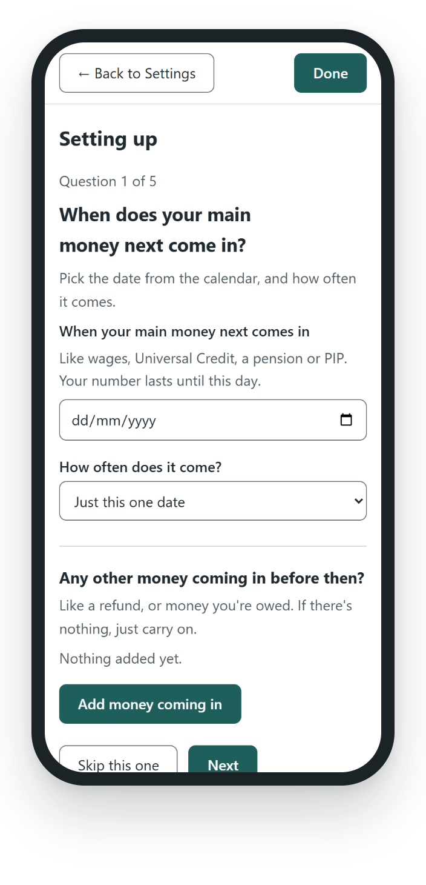</td>
    <td>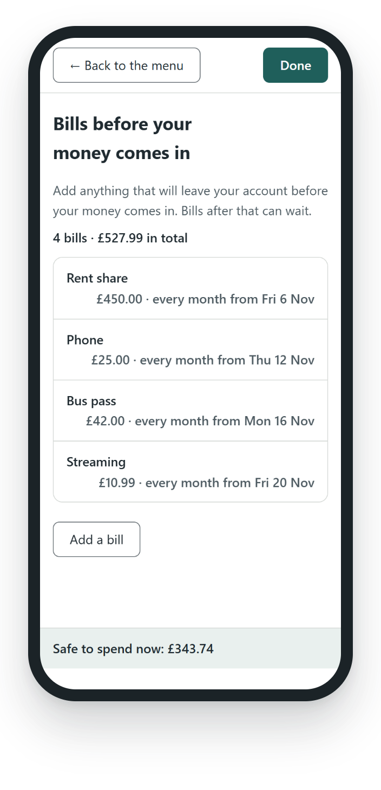</td>
  </tr>
  <tr>
    <td align="center">A calm hello</td>
    <td align="center">One question at a time</td>
    <td align="center">Bills, one line each</td>
  </tr>
</table>

- **Step-by-step setup**: one question per screen, and every question can be skipped.
- **Money and bills that repeat**: weekly, every 2 or 4 weeks, or monthly. The date your money comes in rolls forward by itself.
- **UK bank holidays built in** (England and Wales, Scotland or Northern Ireland). Nothing is looked up online.
- A kind note when your money has come in since you last updated your balance, and **reminders as often as you like**, or never.

### Make it yours

<table>
  <tr>
    <td></td>
    <td>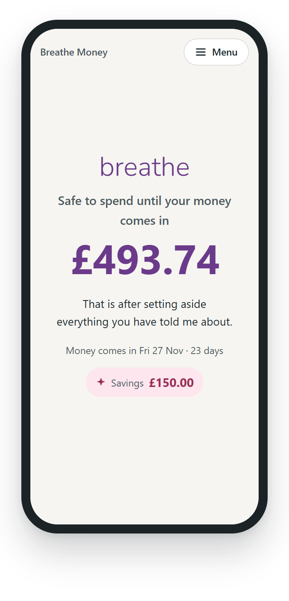</td>
    <td>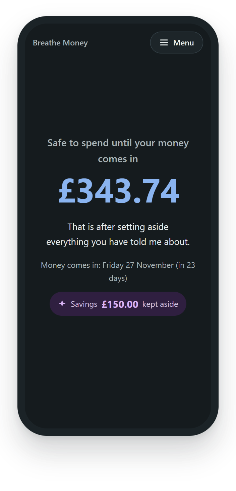</td>
  </tr>
  <tr>
    <td align="center">Dark mode</td>
    <td align="center">Nine app colours</td>
    <td align="center">Nine savings colours</td>
  </tr>
</table>

- **Light or dark**, or follow your device.
- Pick an **app colour** and a **savings colour**, because what feels calm is different for everyone.
- **Hide the extras** under your number once you know your way around (the short sentence, the date, and your savings), so the home screen can be as quiet as you like. Your savings are still kept aside.

<table>
  <tr>
    <td><picture><source media="(prefers-color-scheme: dark)" srcset="docs/images/simple-fade-dark.gif">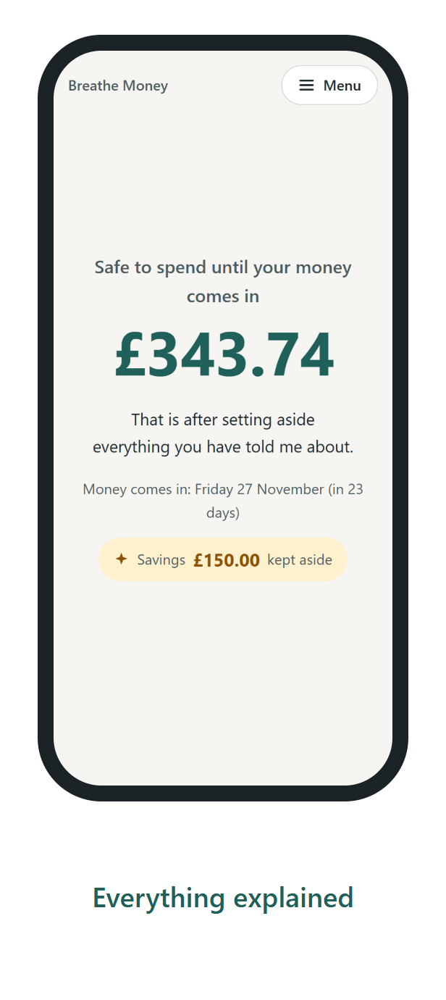</picture></td>
    <td align="center" width="420">
      <picture><source media="(prefers-color-scheme: dark)" srcset="docs/images/saying-dark.png">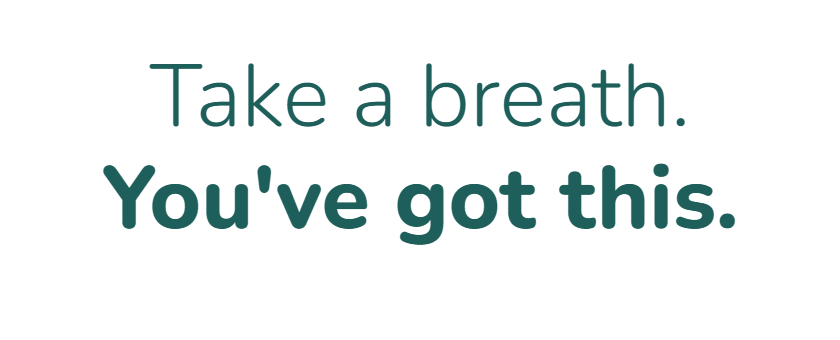</picture>
        
      Like it simpler? Switch off the extras in <b>Menu → Settings → App options</b>.
    </td>
  </tr>
</table>

### Easy to read, private by design

<table>
  <tr>
    <td>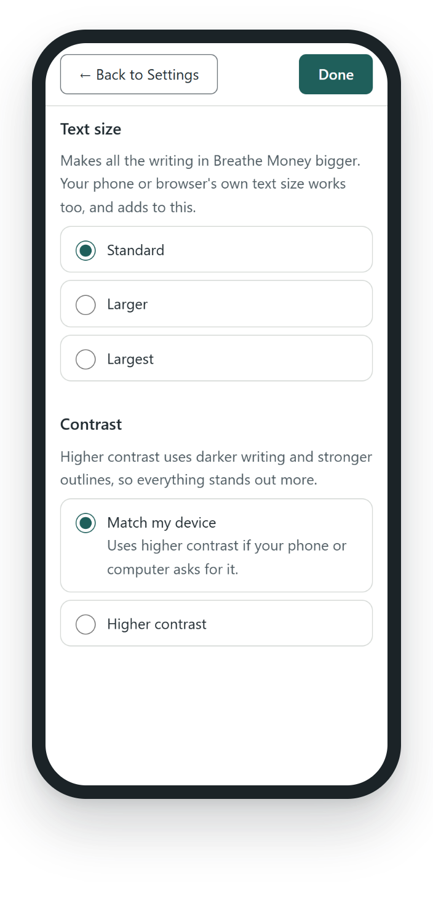</td>
    <td>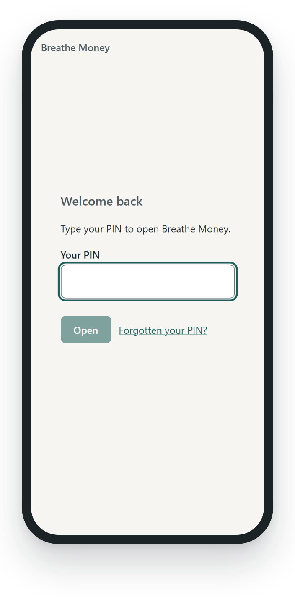</td>
    <td>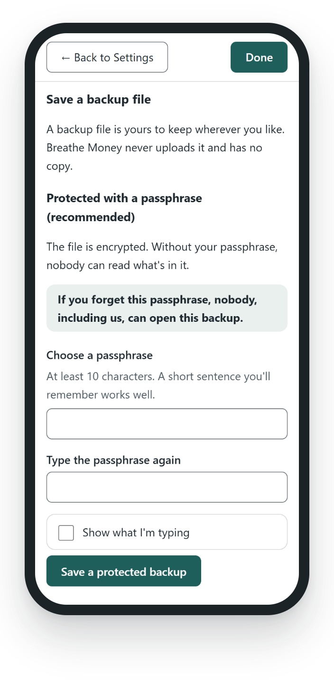</td>
  </tr>
  <tr>
    <td align="center">Bigger text, higher contrast</td>
    <td align="center">An optional PIN privacy screen</td>
    <td align="center">Backups protected with a passphrase</td>
  </tr>
</table>

- **Text size** and **higher contrast** settings, on top of your device's own. It works with the keyboard alone and is built for screen readers ([accessibility checklist](docs/STAGE-9.md#accessibility-checklist)).
- An optional **privacy screen**: a PIN when the app opens, and again after a minute away.
- **Backup files protected with a passphrase**, encrypted with your browser's own built-in tools.

## Your numbers stay yours

- **No accounts, no sign-up, no tracking, no adverts.** There is no Breathe server. Nothing you type is sent anywhere.
- Your numbers are kept **on your own device, inside your web browser**.
- **Honest about the limits:**
  - Numbers saved in the browser are **not encrypted**. The PIN privacy screen stops someone glancing at them, but it isn't encryption, and the app says so.
  - Your browser can remove them, for example if you clear your browsing data. A **backup file** is the safety net. Choose **protected with a passphrase** (recommended) or plain. If you forget the passphrase, nobody, including us, can open the file.
- You can clear everything from the app at any time.

More detail: [PRIVACY.md](PRIVACY.md) and [Storage and backups](docs/STORAGE-AND-BACKUPS.md).

> Breathe Money is an organisation tool. It is **not** financial advice.

## Try it

- **On any phone or computer:** open **[papareaps.github.io/Breathe](https://papareaps.github.io/Breathe/)**. To keep it on your phone: on Android, use the menu and choose **Install app**; on iPhone, tap **Share → Add to Home Screen**. It works offline after the first visit. More in [Stage 10](docs/STAGE-10.md).
- **Android app:** download the `.apk` from the **[latest release](https://github.com/PapaReaps/Breathe/releases/latest)** and open it on your phone. [How to install it, and what's different](docs/ANDROID-APP.md).
- **Run it on your own computer:** the steps are written in plain English for Windows: [Setting up your Windows computer](docs/RUNNING-ON-WINDOWS.md).

## Status

**An early test version, built one small stage at a time.** It works and is tested, but it isn't finished, and things will change. Follow the plan in the [Roadmap](docs/ROADMAP.md). Each stage has a short write-up in [`docs/`](docs/).

## The Breathe family

| App | What it will help with | Status |
|---|---|---|
| **Breathe Money** | Knowing how much you have to spend until your money comes in | **In progress** |
| Breathe Medication | Medication reminders and tracking | Later |
| Breathe Travel | Making independent travel easier | Later |
| Breathe Daily | Routines and reminders | Later |

Each app works on its own. One day you may be able to combine them in an optional "Breathe Home" dashboard.

## Our principles

- No accounts, no sign-up, no personal details.
- Your data stays on your device.
- No adverts, no tracking, no analytics.
- Calm, kind wording. No shame, guilt, streaks or pressure.
- Essential features are always free.
- Breathe is an organisation tool, **not** a financial adviser.
- Only made-up data in pictures, tests and examples. Never real people's details.

<b>What's in this folder</b>

| Folder or file | Purpose |
|---|---|
| `apps/money/` | Breathe Money |
| `packages/design/` | Shared look and feel (empty until branding is agreed) |
| `docs/` | Plans and design notes, written in plain English |
| `PRIVACY.md` | Exactly where your information lives |
| `CONTRIBUTING.md` | How others can help, and the rules we all follow |

## Read next

- [Founding promise](docs/FOUNDING-PROMISE.md)
- [Roadmap](docs/ROADMAP.md)
- [How safe-to-spend is calculated](docs/CALCULATION-DESIGN.md)
- [Storage and backups](docs/STORAGE-AND-BACKUPS.md)
- [Branding (still being explored)](docs/BRANDING.md)
- [Open decisions](docs/DECISIONS.md)
- [Contributing](CONTRIBUTING.md)

## Licence

Breathe is free software, licensed under the **GNU General Public License, version 3 or later** (GPL-3.0-or-later). The full text is in [LICENSE](LICENSE).

In plain English: anyone can use, study, share and change Breathe for free. If they share a changed version, they must share their changes too, under the same licence. That keeps Breathe free for everyone, in the spirit of its founding promise.

This is a plain-English summary, not legal advice.
