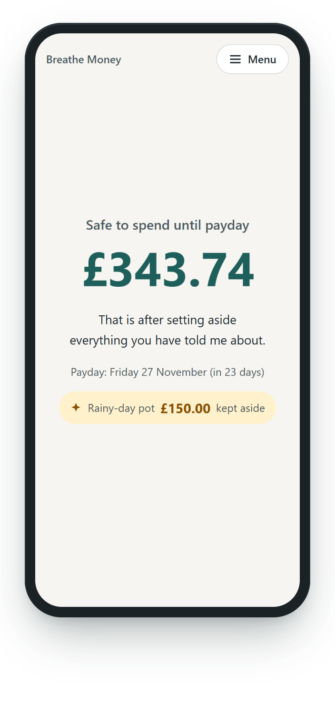
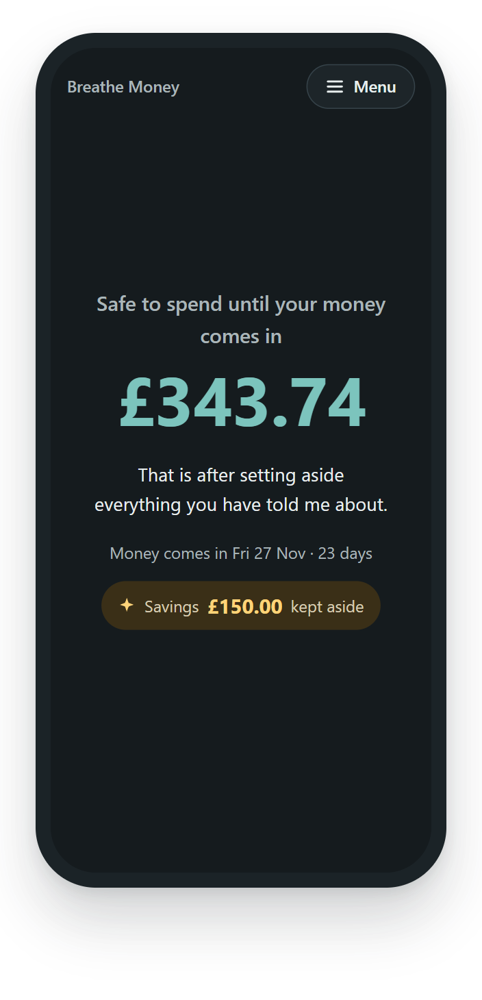
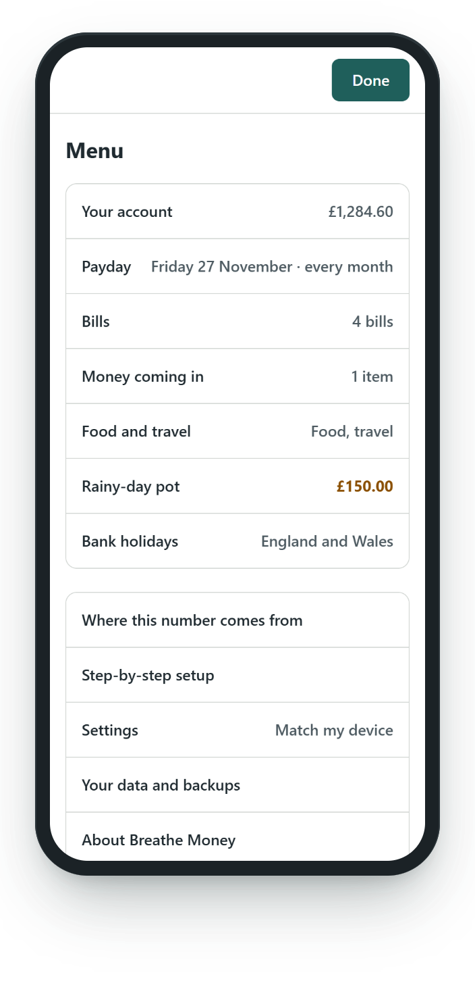
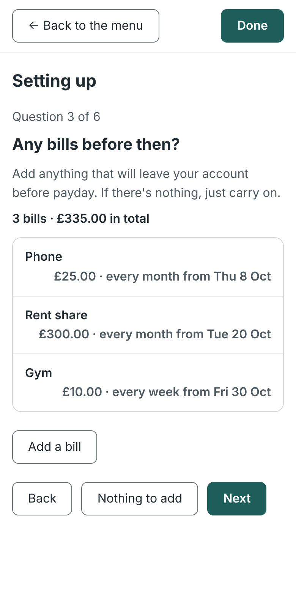
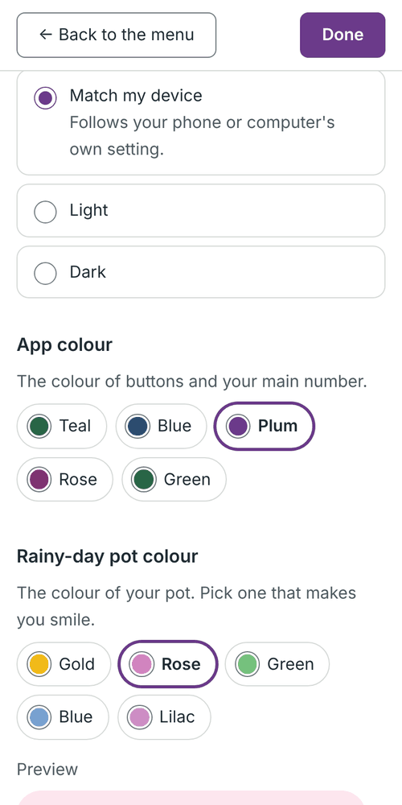
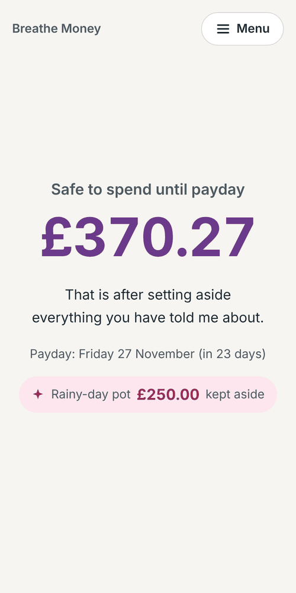
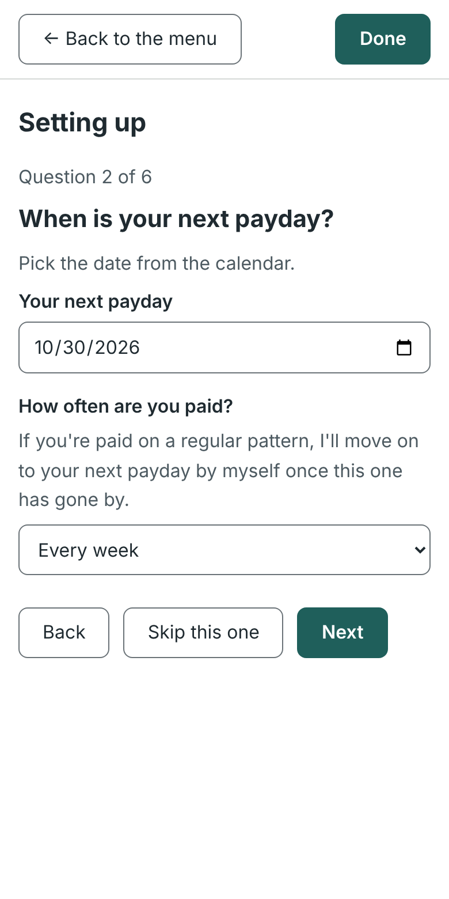
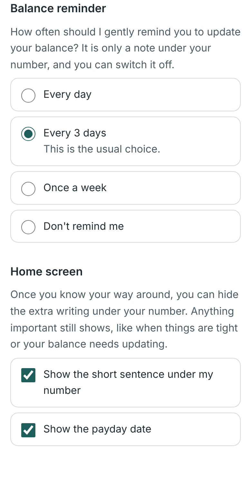

# Breathe

> **Breathe will never be about making money. It will always be about helping people.**

Breathe is a family of free, open-source apps that make everyday life easier for people with ADHD, and for anyone who finds everyday organisation hard.

It is a personal project, built by someone who struggles with these things too. There is enough stress in the world already. Breathe apps should reduce stress, never add to it.

## Breathe Money: "How much can I spend until payday?"

The first app is **Breathe Money**. It answers one question, calmly, on one screen:

<table>
  <tr>
    <td></td>
    <td></td>
    <td></td>
  </tr>
  <tr>
    <td align="center">Your number, at a glance</td>
    <td align="center">Dark mode, if you prefer it</td>
    <td align="center">Everything else lives in the Menu</td>
  </tr>
</table>

*All numbers in these pictures are made up.*

### What it does

- Shows how much is **safe to spend until payday**, after your bills, food and travel, and a rainy-day pot you choose to keep aside.
- Counts every pound **once**. Bills already taken from your balance are not taken off twice, and money that might not arrive is never counted.
- Handles real life: paydays that fall on weekends or bank holidays, bills due on payday, and a balance that is a few days old.
- Knows the **UK bank holidays** (England and Wales, Scotland or Northern Ireland), built in, so you don't have to type them. Nothing is looked up online.
- Copes with **paydays and bills that repeat**: paid weekly, every 2 or 4 weeks, or monthly, and bills that come round on the same pattern. Payday rolls forward by itself.
- Gently says when a payday has gone by since you last updated your balance, and lets you choose **how often it reminds you** (or not at all).
- Starts with a **gentle step-by-step setup**: one question per screen, and every question can be skipped.
- Keeps long lists **tidy**: each bill is one short line, and you open one at a time.
- Lets you choose **light or dark**, an **app colour** and a **rainy-day pot colour**, because what feels calm is different for everyone.
- Lets you **hide the extra writing** under your number once you know your way around, so the home screen can be as quiet as you like.
- Explains **where the number comes from**, line by line, so you never have to just trust it.

<table>
  <tr>
    <td></td>
    <td></td>
    <td></td>
  </tr>
  <tr>
    <td align="center">Tidy bills</td>
    <td align="center">Colour choices</td>
    <td align="center">Make it yours</td>
  </tr>
</table>

<table>
  <tr>
    <td></td>
    <td></td>
  </tr>
  <tr>
    <td align="center">Paid weekly or monthly? Say so once</td>
    <td align="center">Reminders, your way</td>
  </tr>
</table>

### Your numbers stay yours

- **No accounts, no sign-up, no tracking, no adverts.** There is no Breathe server. Nothing you type is sent anywhere.
- Your numbers are kept **on your own device, inside your web browser**.
- **Being honest about the limits:** they are **not encrypted**, so anyone who can open that browser on that device could see them, and your browser can remove them (for example if you clear your browsing data). The app says this in plain words, and offers a **backup file** (also not encrypted, and marked clearly as such). Passphrase-encrypted backups are planned.
- You can clear everything from the app at any time.

More detail: [PRIVACY.md](PRIVACY.md) and [Storage and backups](docs/STORAGE-AND-BACKUPS.md).

> Breathe Money is an organisation tool. It is **not** financial advice.

## Status

**An early test version, still being built, one small stage at a time.** It works and is being tested by hand, but it is not finished and not yet easy to install. Things will change.

You can follow the plan in the [Roadmap](docs/ROADMAP.md). Each stage has a short write-up in [`docs/`](docs/).

### Trying it yourself

For now you run it on your own computer. It takes a few minutes the first time, and the steps are written in plain English for Windows: [Setting up your Windows computer](docs/RUNNING-ON-WINDOWS.md).

**No installing needed:** Breathe Money is also published for free on GitHub Pages, so it can be opened from a link, added to a phone's home screen, and used offline. See [Stage 10](docs/STAGE-10.md) for how it is published and how to add it to your home screen.

## The Breathe family

| App | What it will help with | Status |
|---|---|---|
| **Breathe Money** | Knowing how much you have to spend until payday | **In progress** |
| Breathe Medication | Medication reminders and tracking | Later |
| Breathe Travel | Making independent travel easier | Later |
| Breathe Daily | Routines and reminders | Later |

Each app works on its own. One day you may be able to combine them in an optional "Breathe Home" dashboard.

## Our principles

- No accounts, no sign-up, no personal details.
- Your data stays on your device.
- No adverts, no tracking, no analytics.
- Calm, kind wording. No shame, guilt, streaks or pressure.
- Essential features are always free.
- Breathe is an organisation tool, **not** a financial adviser.
- Only made-up data in pictures, tests and examples. Never real people's details.

## What is in this folder

| Folder or file | Purpose |
|---|---|
| `apps/money/` | Breathe Money |
| `packages/design/` | Shared look and feel (empty until branding is agreed) |
| `docs/` | Plans and design notes, written in plain English |
| `PRIVACY.md` | Exactly where your information lives |
| `CONTRIBUTING.md` | How others can help, and the rules we all follow |

## Read next

- [Founding promise](docs/FOUNDING-PROMISE.md)
- [Roadmap](docs/ROADMAP.md)
- [How safe-to-spend is calculated](docs/CALCULATION-DESIGN.md)
- [Storage and backups](docs/STORAGE-AND-BACKUPS.md)
- [Branding (still being explored)](docs/BRANDING.md)
- [Open decisions](docs/DECISIONS.md)
- [Setting up your Windows computer](docs/RUNNING-ON-WINDOWS.md)

## Licence

Breathe is free software, licensed under the **GNU General Public License, version 3 or later** (GPL-3.0-or-later). The full text is in [LICENSE](LICENSE).

In plain English: anyone can use, study, share and change Breathe for free. If they share a changed version, they must share their changes too, under the same licence. That keeps Breathe free for everyone, in the spirit of its founding promise.

This is a plain-English summary, not legal advice.
