

  <picture>
    <source media="(prefers-color-scheme: dark)" srcset="docs/images/breathe-dark.gif">
    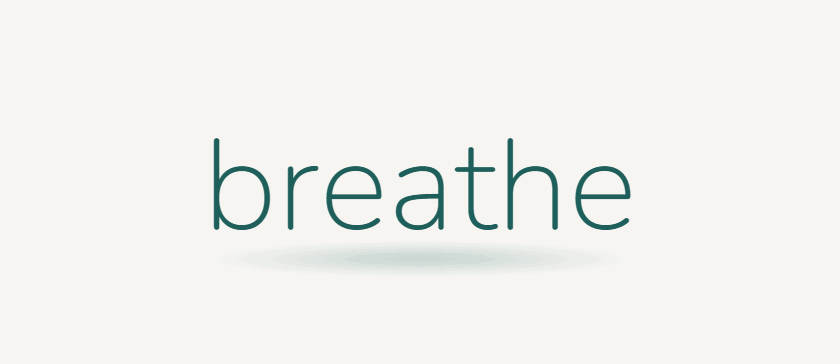
  </picture>

# Breathe

> **Breathe will never be about making money. It will always be about helping people.**

  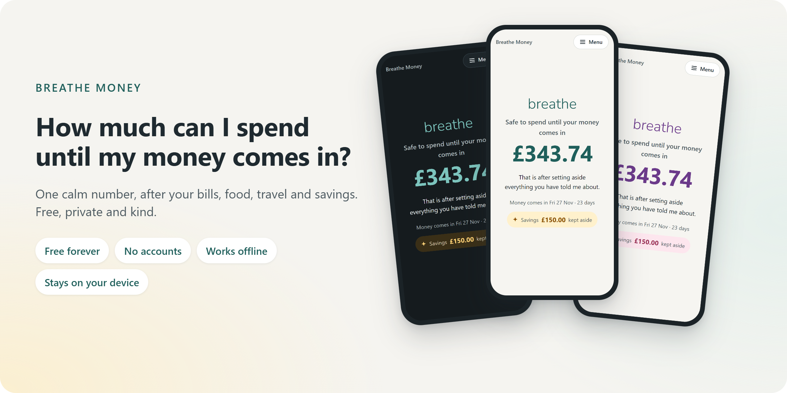

  <a href="https://papareaps.github.io/Breathe/"><b>Open Breathe Money →</b></a>
  &nbsp;·&nbsp; Free &nbsp;·&nbsp; No sign-up &nbsp;·&nbsp; Works offline &nbsp;·&nbsp; Add it to your phone's home screen

## Get it in 3 taps

Free, with no sign-up. Point your phone camera at a code, or tap the link on your phone.

<table>
  <tr>
    <td align="center" valign="top">
      <a href="https://github.com/PapaReaps/Breathe/releases/latest/download/breathe-money.apk">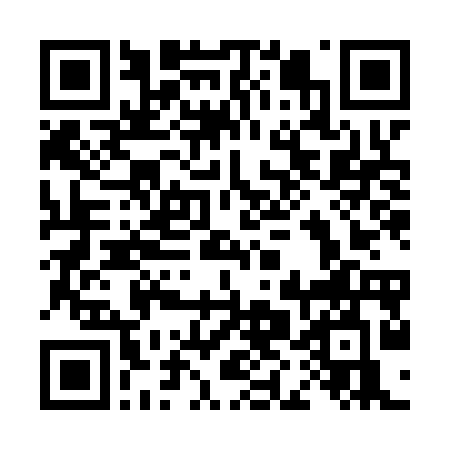</a> 
      <b>Android</b> 
      <a href="https://github.com/PapaReaps/Breathe/releases/latest/download/breathe-money.apk">Download →</a> 
      Tap Open, then Install.
    </td>
    <td align="center" valign="top">
      <a href="https://papareaps.github.io/Breathe/">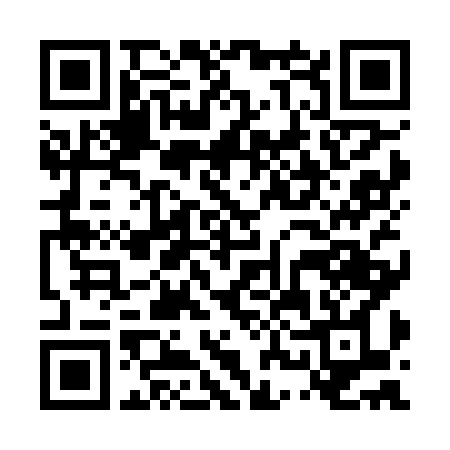</a> 
      <b>iPhone</b> 
      <a href="https://papareaps.github.io/Breathe/">Open →</a> 
      Or any computer.
    </td>
  </tr>
</table>

**On a computer?** Open [papareaps.github.io/Breathe](https://papareaps.github.io/Breathe/) in Chrome or Edge and click **Install** at the right of the address bar. It opens in its own window, works offline and updates itself.

Already have it? Show a friend the code on your own phone: **Menu → Settings → Help and sharing → Share Breathe Money**.

Breathe is a family of free, open-source apps that make everyday life easier for people with ADHD, and for anyone who finds everyday organisation hard.

It is a personal project, built by someone who struggles with these things too. There is enough stress in the world already. Breathe apps should reduce stress, never add to it.

## Breathe Money in 15 seconds

  <picture><source media="(prefers-color-scheme: dark)" srcset="docs/images/demo-clip-dark.gif">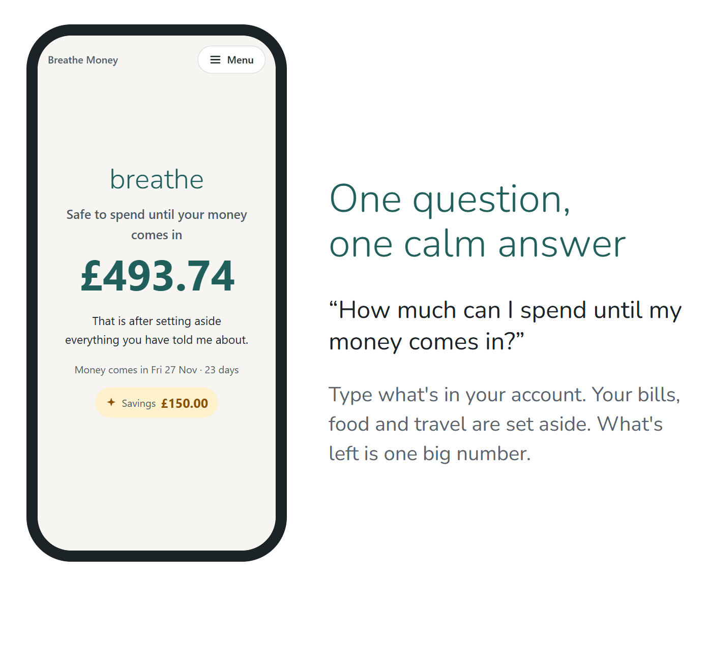</picture>

<a href="https://papareaps.github.io/Breathe/"><b>Try it now →</b></a> No account, no download.

*All numbers in these pictures are made up.*

## What it does

### Your number, and where it comes from

  <picture>
    <source media="(prefers-color-scheme: dark)" srcset="docs/images/row-number-dark.png">
    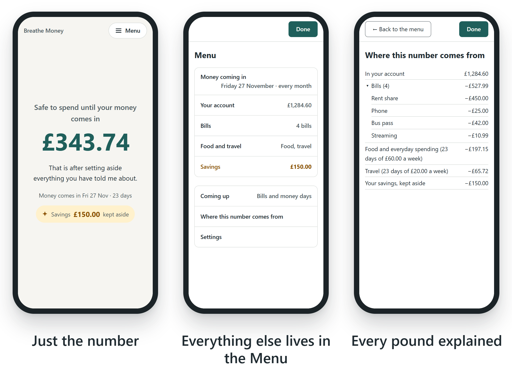
  </picture>

- Shows how much is **safe to spend until your money comes in** (wages, benefits or a pension), after your bills, food and travel.
- Counts every pound **once**. Bills already taken from your balance aren't taken off twice.
- Never counts money that isn't here yet. Each payment only counts from the day it arrives, and a small badge says when (like **+£140.00 on Mon 9 Nov**).
- Explains **where the number comes from**, line by line, so you never have to just trust it.
- Handles real life: money that comes in on a weekend or bank holiday, bills due on that day, and a balance that's a few days old.

### Gentle setup, tidy lists

  <picture>
    <source media="(prefers-color-scheme: dark)" srcset="docs/images/row-setup-dark.png">
    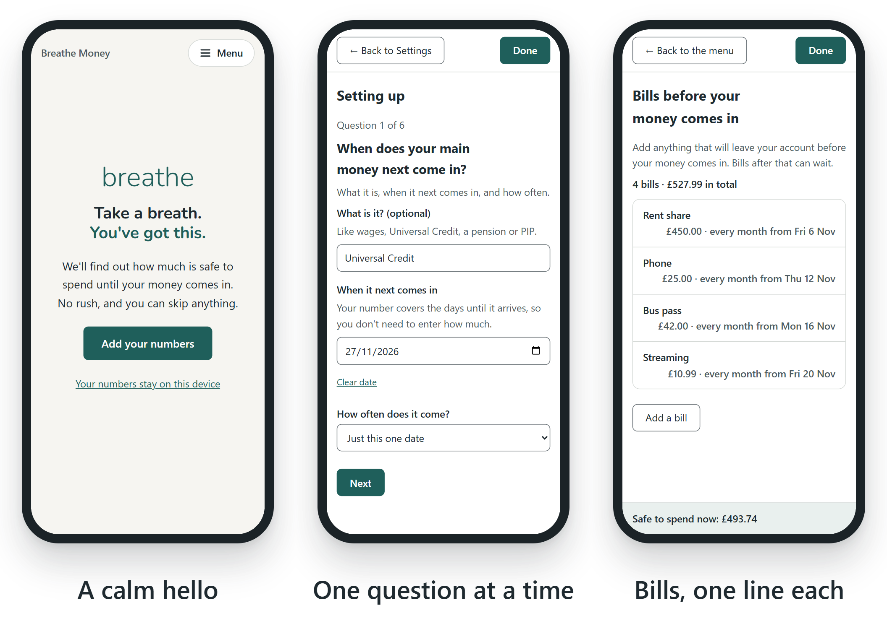
  </picture>

- **Step-by-step setup**: one question per screen, and every question can be skipped.
- **Just add all your money coming in**: wages, Universal Credit, PIP, Child Benefit, a pension. There's no "main" one to pick: your number plans until your biggest regular payment by itself, and you can change it in the Menu.
- **Money and bills that repeat**: weekly, every 2 or 4 weeks, or monthly. The date your money comes in rolls forward by itself.
- **UK bank holidays built in** (England and Wales, Scotland or Northern Ireland). Nothing is looked up online.
- A kind note when your money has come in since you last updated your balance, and **reminders as often as you like**, or never.

> [!TIP]
> **You only really need to set it up once.** Depending on how things change for you, that might be all. After that it's just your balance now and then.
>
> And you never have to do it alone. Ask someone you trust, like a friend, family member or support worker, to sit with you while you set it up.

### Your calendar

  <picture>
    <source media="(prefers-color-scheme: dark)" srcset="docs/images/row-calendar-v2-dark.png">
    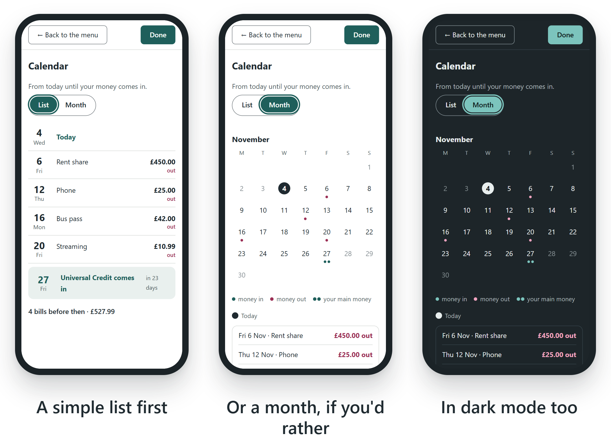
  </picture>

- **Calendar** shows your bills and the day your money comes in, from today until then. Each amount says **in** or **out**. Switch between **List** and **Month**, and the app remembers which you like. In the month, small dots show each day's money (teal in, rose out, two dots for your main money), today is circled, and every amount is listed underneath.

### Make it yours

  <picture>
    <source media="(prefers-color-scheme: dark)" srcset="docs/images/row-yours-v2-dark.png">
    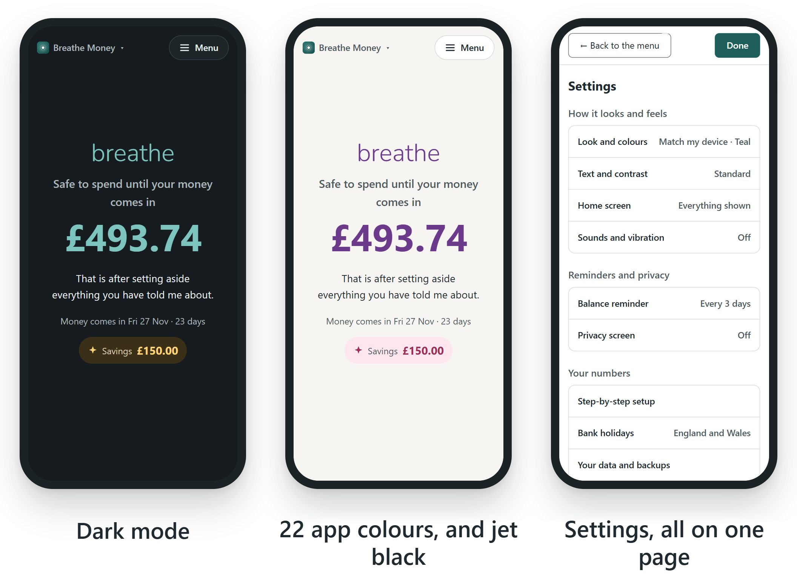
  </picture>

- **App options is a short, calm list**: Look and colours, Text and contrast, Home screen, Balance reminder, Sounds and vibration, Privacy screen and Updates. Each opens its own small page.
- **Light, dark or jet black**, or follow your device.
- Pick from **22 app colours** (soft or deep) and a **savings colour**, each from a simple list, because what feels calm is different for everyone. You can even choose the colour of the **box outlines**.
- **Sounds and vibration when you tap**, if you'd like them: twelve soft sounds and three strengths of buzz, each with a button to try it first. All off until you choose.
- **A calm opening:** "breathe" takes one deep breath, slowly floats up, and keeps breathing gently above your number. Prefer it still? Switch off **Let "breathe" breathe**. It's always still if your phone is set to reduce motion.
- **Keep track of your savings** separately: type what you've saved, then add to it or take some out with one tap. Savings never change your number.
- **Hide the extras** under your number once you know your way around (the short sentence, the date, and your savings), so the home screen can be as quiet as you like. What your money is called (like "Universal Credit") stays off the home screen unless you choose to show it.

  <picture>
    <source media="(prefers-color-scheme: dark)" srcset="docs/images/simple-fade-saying-dark.gif">
    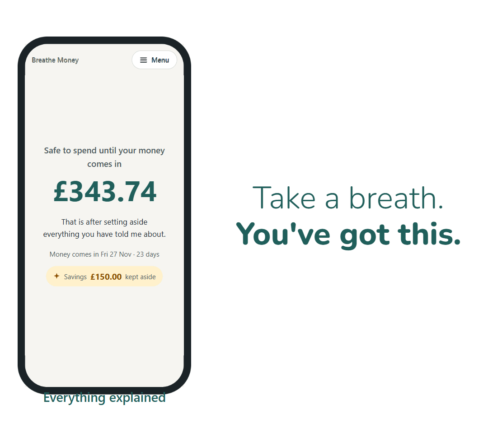
  </picture>

Like it simpler? Switch off the extras in <b>Menu → Settings → App options → Home screen</b>.

### Share it, tell us, keep it up to date

  <picture>
    <source media="(prefers-color-scheme: dark)" srcset="docs/images/row-share-dark.png">
    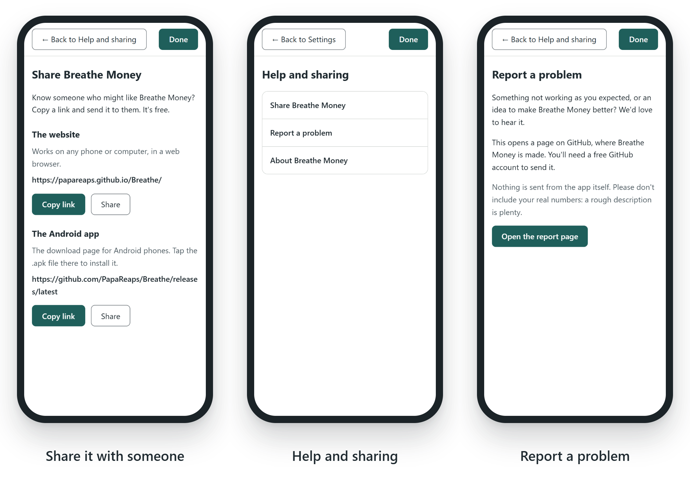
  </picture>

- **Share Breathe Money**: show a friend a QR code to scan, or copy or share the link (the Android app, or the web version for iPhones and computers).
- **Leave a tip**: Breathe is free, always. If it's helped, you can say thanks with £3, £5 or £10, on Stripe's secure page. Only if you can spare it: tips don't unlock anything, and Breathe never sees your card details.
- **Report a problem**: opens a GitHub page to tell us what happened, or share an idea. Nothing is sent from the app itself.
- **Updates in the Android app**: the first time, the app asks once whether to check for new versions. Say yes, and a clear **Update ready** button shows under your number whenever there is one. Or tap **Check now** yourself, then **Download and install**. The app only downloads Breathe Money's own releases, and Android checks every update is really from us.

Share, Leave a tip and Report a problem are in **Menu → Settings → Help and sharing**. Updates are in **Menu → Settings → App options → Updates**.

### Easy to read, private by design

  <picture>
    <source media="(prefers-color-scheme: dark)" srcset="docs/images/row-private-dark.png">
    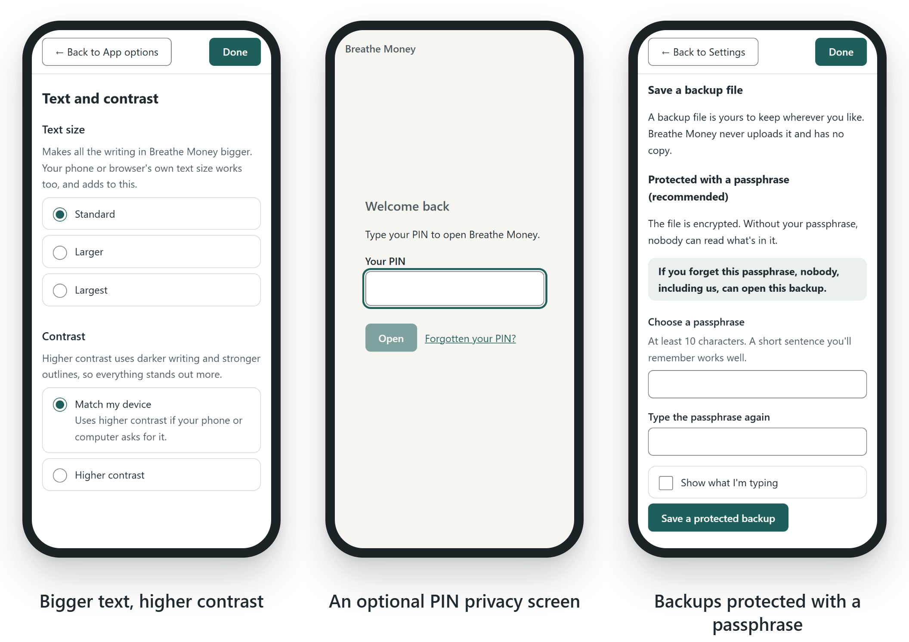
  </picture>

- **Text size** and **higher contrast** settings, on top of your device's own. It works with the keyboard alone and is built for screen readers ([accessibility checklist](docs/STAGE-9.md#accessibility-checklist)).
- An optional **privacy screen**: a PIN when the app opens, and again after a minute away.
- **Backup files protected with a passphrase**, encrypted with your browser's own built-in tools.

## Your numbers stay yours

- **No accounts, no sign-up, no tracking, no adverts.** There is no Breathe server. Nothing you type is sent anywhere.
- Your numbers are kept **on your own device, inside your web browser**.
- **Honest about the limits:**
  - Numbers saved in the browser are **not encrypted**. The PIN privacy screen stops someone glancing at them, but it isn't encryption, and the app says so.
  - Your browser can remove them, for example if you clear your browsing data. A **backup file** is the safety net. Choose **protected with a passphrase** (recommended) or plain. If you forget the passphrase, nobody, including us, can open the file.
- You can clear everything from the app at any time.

More detail: [PRIVACY.md](PRIVACY.md) and [Storage and backups](docs/STORAGE-AND-BACKUPS.md).

> Breathe Money is an organisation tool. It is **not** financial advice.

## Try it

- **On any phone or computer:** open **[papareaps.github.io/Breathe](https://papareaps.github.io/Breathe/)**. To keep it on your phone: on Android, use the menu and choose **Install app**; on iPhone, tap **Share → Add to Home Screen**. It works offline after the first visit. More in [Stage 10](docs/STAGE-10.md).
- **On your computer, as an app:** open the web link in **Chrome** or **Edge** and click the **Install** icon at the right-hand end of the address bar (or open the **⋮** menu and choose **Install Breathe Money**; in Edge it's **Apps → Install this site as an app**). It gets its own window and a Start menu or Dock icon, works offline, and updates itself each time you open it with internet. Your numbers are never touched by updates.
- **Android app:** on your Android phone, **[tap here to download it](https://github.com/PapaReaps/Breathe/releases/latest/download/breathe-money.apk)**, then open it. (Or pick the `.apk` from the [latest release](https://github.com/PapaReaps/Breathe/releases/latest).) A friend who has it can also show you a QR code: **Menu → Settings → Help and sharing → Share Breathe Money**. After that, new versions download and install from inside the app: **Menu → Settings → App options → Updates**. [How to install it, and what's different](docs/ANDROID-APP.md).
- **Build it yourself (for developers):** the steps are written in plain English for Windows: [Setting up your Windows computer](docs/RUNNING-ON-WINDOWS.md).

## Status

**An early test version, built one small stage at a time.** It works and is tested, but it isn't finished, and things will change. Follow the plan in the [Roadmap](docs/ROADMAP.md). Each stage has a short write-up in [`docs/`](docs/).

## The Breathe family

| App | What it will help with | Status |
|---|---|---|
| **Breathe Money** | Knowing how much you have to spend until your money comes in | **In progress** |
| Breathe Medication | Medication reminders and tracking | Later |
| Breathe Travel | Making independent travel easier | Later |
| Breathe Reminders | Routines and reminders | Later |

Each app works on its own. One day you may be able to combine them in an optional "Breathe Home" dashboard.

## Support Breathe

Breathe will always be free, with no adverts and nothing to unlock. If it's helped you and you'd like to say thanks, you can leave a tip. Only if you can spare it.

  <a href="https://buy.stripe.com/bJe8wRefe6om4abfrC3cc00"><b>Tip £3</b></a>
  &nbsp;·&nbsp;
  <a href="https://buy.stripe.com/7sYbJ35IIfYW8qr4MY3cc01"><b>Tip £5</b></a>
  &nbsp;·&nbsp;
  <a href="https://buy.stripe.com/28E5kF6MM142bCD6V63cc02"><b>Tip £10</b></a>

Each opens Stripe's secure payment page (card, Google Pay or Apple Pay). Tips go towards keeping Breathe going, and the Breathe apps still to come. You'll also find **Leave a tip** in the app: **Menu → Settings → Help and sharing**.

## Our principles

- No accounts, no sign-up, no personal details.
- Your data stays on your device.
- No adverts, no tracking, no analytics.
- Calm, kind wording. No shame, guilt, streaks or pressure.
- Essential features are always free.
- Breathe is an organisation tool, **not** a financial adviser.
- Only made-up data in pictures, tests and examples. Never real people's details.

<b>What's in this folder</b>

| Folder or file | Purpose |
|---|---|
| `apps/money/` | Breathe Money |
| `packages/design/` | Shared look and feel (empty until branding is agreed) |
| `docs/` | Plans and design notes, written in plain English |
| `PRIVACY.md` | Exactly where your information lives |
| `CONTRIBUTING.md` | How others can help, and the rules we all follow |

## Read next

- [Founding promise](docs/FOUNDING-PROMISE.md)
- [Roadmap](docs/ROADMAP.md)
- [How safe-to-spend is calculated](docs/CALCULATION-DESIGN.md)
- [Storage and backups](docs/STORAGE-AND-BACKUPS.md)
- [Branding (the opening breath and the app icon are chosen)](docs/BRANDING.md)
- [Open decisions](docs/DECISIONS.md)
- [Contributing](CONTRIBUTING.md) and our [Code of conduct](CODE_OF_CONDUCT.md)
- [Accessibility](ACCESSIBILITY.md): what Breathe does, and its known limits
- [Security policy](SECURITY.md): how to tell us about a safety problem privately

## Licence

Breathe is free software, licensed under the **GNU General Public License, version 3 or later** (GPL-3.0-or-later). The full text is in [LICENSE](LICENSE).

In plain English: anyone can use, study, share and change Breathe for free. If they share a changed version, they must share their changes too, under the same licence. That keeps Breathe free for everyone, in the spirit of its founding promise.

This is a plain-English summary, not legal advice.
