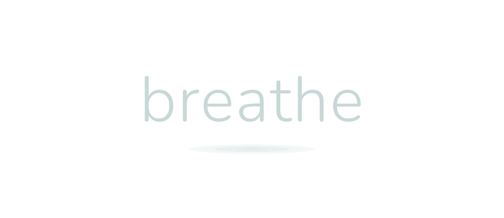
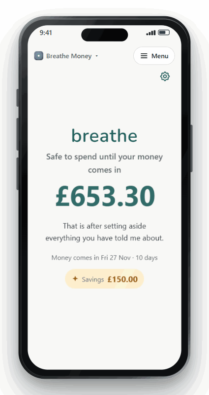
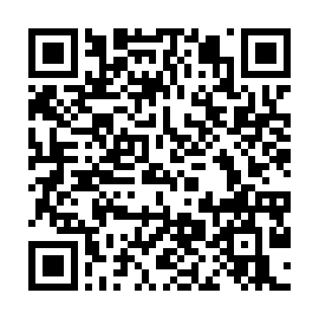
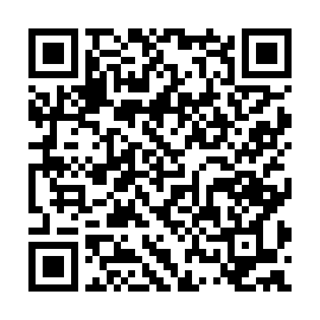
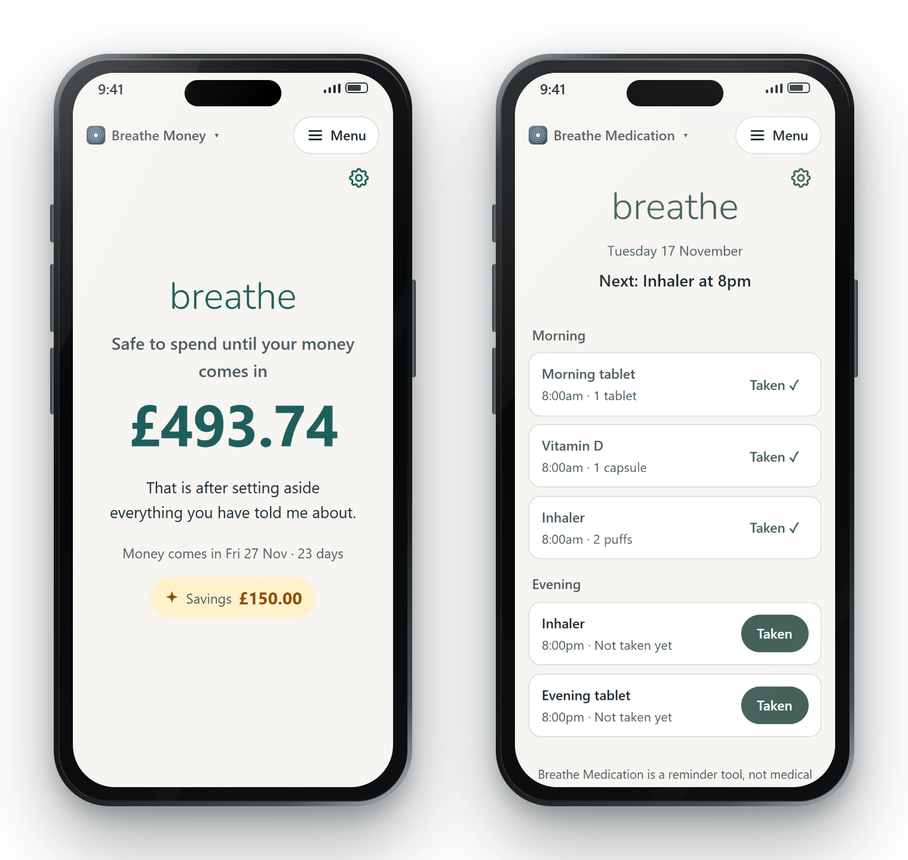

  <picture>
    <source media="(prefers-color-scheme: dark)" srcset="docs/images/breathe-ripple-dark.gif">
    
  </picture>

<h1 align="center">Breathe</h1>

  <b>Calm, simple apps for ADHD brains.</b> 
  Free forever · No accounts · Works offline · Stays on your device

  <picture>
    <source media="(prefers-color-scheme: dark)" srcset="docs/images/clip-v4-dark.gif">
    
  </picture>

## Get it

  <a href="https://github.com/PapaReaps/Breathe/releases/latest/download/breathe-money.apk"><b>Android app →</b></a>
  &nbsp;&nbsp;·&nbsp;&nbsp;
  <a href="https://papareaps.github.io/Breathe/"><b>iPhone or computer →</b></a>

<b>QR codes, computers and Obtainium</b>

 

Point your phone camera at a code.

<table>
  <tr>
    <td align="center" valign="top">
       
      <b>Android</b> 
      Tap Open, then Install.
    </td>
    <td align="center" valign="top">
       
      <b>iPhone</b> 
      Tap Share, then Add to Home Screen.
    </td>
  </tr>
</table>

- **On a computer:** open [papareaps.github.io/Breathe](https://papareaps.github.io/Breathe/) in Chrome or Edge and click **Install** at the right of the address bar. It opens in its own window, works offline and updates itself.
- **Updates on Android:** inside the app, tap the **gear → Updates**. [How to install it, and what's different](docs/ANDROID-APP.md).
- **Obtainium:** on your phone, tap **[Add to Obtainium →](https://apps.obtainium.imranr.dev/redirect?r=obtainium://app/%7B%22id%22%3A%22io.github.papareaps.breathe.money%22%2C%22url%22%3A%22https%3A%2F%2Fgithub.com%2FPapaReaps%2FBreathe%22%2C%22author%22%3A%22PapaReaps%22%2C%22name%22%3A%22Breathe%20Money%22%2C%22additionalSettings%22%3A%22%7B%5C%22apkFilterRegEx%5C%22%3A%5C%22%5Ebreathe-money%5C%5C%5C%5C.apk%24%5C%22%2C%5C%22fallbackToOlderReleases%5C%22%3Atrue%7D%22%7D)**. It installs Breathe straight from these releases and keeps it up to date. If you add it by pasting `https://github.com/PapaReaps/Breathe` instead, set **Filter APKs by regular expression** to `^breathe-money\.apk$`.
- **Already have it?** Show a friend the code on your own phone: **gear → Help and sharing → Share Breathe**.
- **Build it yourself:** [Setting up your Windows computer](docs/RUNNING-ON-WINDOWS.md), in plain English.

## Two parts, one calm app

  <picture>
    <source media="(prefers-color-scheme: dark)" srcset="docs/images/phones-v1-dark.png">
    
  </picture>

<table>
  <tr>
    <td width="50%" valign="top">
      <b>Money</b> 
      How much can I spend until my money comes in? Type what's in your account. Your bills, food and travel are set aside, and what's left is one calm number.
    </td>
    <td width="50%" valign="top">
      <b>Medication</b> 
      A calm list of today's medicines. Tap Taken when it's done. Gentle reminders on Android, and a quiet note about a week before something runs out.
    </td>
  </tr>
</table>

Tap the name at the top to switch. The gear holds your settings, and each part keeps its own colour.

## Your data stays yours

- **No accounts, no tracking, no adverts.** There is no Breathe server, and nothing you type is sent anywhere.
- Everything is kept **on your own device**. It isn't encrypted, so a **backup file** (with a passphrase, if you like) is your safety net.
- You can clear everything from the app at any time.

More detail: [PRIVACY.md](PRIVACY.md) and [Storage and backups](docs/STORAGE-AND-BACKUPS.md).

> Breathe Money is an organisation tool, **not** financial advice. Breathe Medication is a reminder tool, **not** medical advice.

<b>Coming later</b>

 

| App | What it helps with | Status |
|---|---|---|
| **Money** | Knowing how much you can spend until your money comes in | Ready |
| **Medication** | A calm daily list, gentle reminders and running-low notes | Ready |
| Travel | Making independent travel easier | Later |
| Reminders | Routines and reminders | Later |

What's next is in the [Roadmap](docs/ROADMAP.md), and each release has short notes in [`docs/releases/`](docs/releases/).

<b>Support Breathe, and follow along</b>

 

Breathe will always be free, with no adverts and nothing to unlock. If it's helped and you'd like to say thanks, you can leave a tip. Only if you can spare it.

  <a href="https://buy.stripe.com/bJe8wRefe6om4abfrC3cc00"><b>Tip £3</b></a>
  &nbsp;·&nbsp;
  <a href="https://buy.stripe.com/7sYbJ35IIfYW8qr4MY3cc01"><b>Tip £5</b></a>
  &nbsp;·&nbsp;
  <a href="https://buy.stripe.com/28E5kF6MM142bCD6V63cc02"><b>Tip £10</b></a>

Each opens Stripe's secure payment page (card, Google Pay or Apple Pay). In the app, it's under **gear → Help and sharing**.

News, new apps and calm tips: [X @breatheapps](https://x.com/breatheapps) · [Instagram @breatheapps](https://www.instagram.com/breatheapps/)

<b>About this project, and our principles</b>

 

> **Breathe will never be about making money. It will always be about helping people.**

Breathe is a personal project, built by someone who finds everyday organisation hard too, with help from Claude, an AI assistant. Every change is planned together, tested, tried on real phones, and published openly here.

- No accounts, no sign-up, no personal details.
- Your data stays on your device.
- No adverts, no tracking, no analytics.
- Calm, kind wording. No shame, guilt, streaks or pressure.
- Essential features are always free.
- Only made-up data in pictures, tests and examples. Never real people's details.

<b>Read next</b>

 

- [Founding promise](docs/FOUNDING-PROMISE.md) and [Roadmap](docs/ROADMAP.md)
- [How safe-to-spend is calculated](docs/CALCULATION-DESIGN.md)
- [Storage and backups](docs/STORAGE-AND-BACKUPS.md)
- [Branding](docs/BRANDING.md) and [Open decisions](docs/DECISIONS.md)
- [Accessibility](ACCESSIBILITY.md): what Breathe does, and its known limits
- [Contributing](CONTRIBUTING.md), [Code of conduct](CODE_OF_CONDUCT.md) and [Security policy](SECURITY.md)

## Licence

Breathe is free software under the **GNU General Public License, version 3 or later** ([LICENSE](LICENSE)). In plain English: anyone can use, study, share and change it for free, and if they share a changed version, they share their changes too. This is a plain-English summary, not legal advice.
